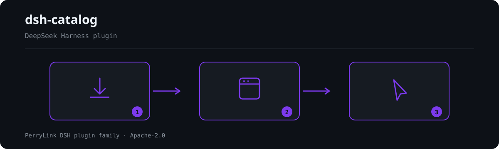

# dsh-catalog

[](LICENSE)
[](https://github.com/topics/dsh-plugin)
[](https://gitee.com/perrylink/dsh-catalog)
[](https://www.npmjs.com/package/dsh-catalog)
[](https://www.npmjs.com/package/dsh-catalog)
[](https://dshfind.com/plugins/PerryLink/dsh-catalog?ref=badge)

A [DSH Community Market](https://github.com/anywhere-labs/dsh-desktop/tree/main/dsh-community-market) **standard catalog source** for the PerryLink DeepSeek Harness plugin family, generated from the npm registry, validated against the public v1 contract schemas. Every item carries a Chinese name and a one-line Chinese summary (`displayNameZh` / `summaryZh`) next to the English pair.

- Manifest: `catalog-source.json` (generated; see Deploy)
- Provider page: `artifacts/v1/plugins.json` (generated)
- Source of truth: `data/packages.json` (npm name → repo → display name → categories) + `data/npm-snapshot.json` (npm registry snapshot)
- Generator / validator: `scripts/build-catalog.mjs`, `scripts/validate.mjs`, `scripts/check-counts.mjs`
- Deploy: live at `https://perrylink-dsh-catalog.perrylink.workers.dev` (Cloudflare Workers, automated via `deploy.yml`; Vercel static alternative in `vercel.json`; Deno unit `deploy/deno-worker.js` as manual alternative)



*Workflow overview: install → open panel → act. The catalog is the discovery surface.*


## Maintenance status: family-internal tool

> **Reclassified on 2026-10-05 — deliberately NOT retired.** A review of the whole
> plugin family against the official harness and the wider ecosystem classified this
> repository as **family-internal tooling** rather than a product. Its job is to
> inventory this family for the DSH Desktop Community Market, so it does not compete
> with third-party catalogs and needs no retirement. It stays maintained.

### One roster, one source

The catalog is the discoverability surface, not a 1:1 projection of the family
roster. It carries npm records in `data/packages.json` (including
community/third-party records and the retired names kept for older installs).
Every per-plugin README carries the same collapsed roster.

## Compliance notes

- Contract: [catalog-provider-contract.md](https://github.com/anywhere-labs/dsh-desktop/blob/main/dsh-community-market/docs/catalog-provider-contract.md) (v1, `manifestVersion`/`schemaVersion` `1.0.0`). The schemas are vendored nowhere in this repo; `scripts/validate.mjs` mirrors the structural rules of `catalog-source.schema.json` and `catalog-provider-page.schema.json` and the cross-field rules (unique item ids, npm name pattern, no install commands in items, HTTPS repository URLs, page shape).
- The minimal valid profile is used: `query.supported = []`, `defaultLimit = maxLimit = 50`, `sorts = []`. The endpoint returns the complete bounded page (99 items in one response), so DSH Desktop scans it in one request and runs search/filtering over its local index. ⚠️ `maxLimit = 50` caps a *slice* request, not this whole-page response — the shipped page is larger than `maxLimit` by design, and the two numbers are not supposed to agree.
- Every item carries `package.registry = "npm"` + `package.name` and a canonical `repository.url`; no install commands, shell fragments or executable data are ever emitted.
- Every item also carries a same-origin `media.icon` (`/icons/<slug>.png`, generated deterministically by `scripts/build-icons.mjs`); the Worker serves the PNGs itself, so the icons stay on the catalog origin as the market media rule requires.
- The manifest endpoint and the manifest itself must share one HTTPS origin (market rule). The generated placeholder endpoint `https://replace-with-deploy-origin.invalid/...` is replaced by the real deploy origin at deploy time — do not register the placeholder URL in DSH Desktop.

## Build

```sh
node scripts/build-catalog.mjs            # placeholder endpoint
node scripts/validate.mjs                 # structural checks
node scripts/build-catalog.mjs https://<your-project>.deno.dev   # real origin
```

`build-catalog.mjs` writes the manifest and provider page to the repo root **and** mirrors both into `deploy/`, so `deploy/deno-worker.js` is a self-contained Deno Deploy unit (its `./` imports always resolve).

`data/npm-snapshot.json` is refreshed UTF-8-safely with:

```sh
node scripts/refresh-snapshot.mjs   # re-fetch every package from registry.npmjs.org
```

> A scheduled workflow (`.github/workflows/refresh-catalog.yml`) runs this daily
> and opens one PR on `chore/catalog-refresh` only when the registry changed.
> It runs the data/artifact/type gates before opening the PR; merging the PR
> triggers the deploy workflow. The manual command above is for a forced
> refresh.

### Maintaining `data/`

`data/packages.json` and `data/npm-snapshot.json` are **one unit**: a new or renamed package
needs its snapshot row *in the same commit*. Two consecutive `main` deploys went red on
2026-09-09 exactly this way — first a missing comma in `data/packages.json`, then a package
listed without its snapshot row (`Error: npm snapshot missing for …`). Both are caught locally
by the pre-push gate; enable it once per clone:

```sh
git config core.hooksPath .githooks   # then every push runs node scripts/check-data.mjs
```

`scripts/check-data.mjs` is read-only. Do **not** use `node scripts/build-catalog.mjs` as a
gate: called without an argument it rewrites the committed `deploy/` artifacts with the
placeholder origin.

The family count is **not** hand-maintained: `scripts/check-counts.mjs` derives it from
`data/packages.json` and holds every place that states it — the README summaries (EN + ZH), the
manifest description, the shipped page's `items`/`page.total` and the deploy live-smoke floor —
to that one source. Run it to verify, or `node scripts/check-counts.mjs --write` to rewrite the
README count sites from the source. It exists because the number did drift: the README and the
manifest advertised a family one package larger than the page actually shipped (the concrete
figures and the commit that fixed them are recorded in the `scripts/check-counts.mjs` header).

`.github/workflows/ci.yml` runs `scripts/check-data.mjs`, `scripts/check-counts.mjs` and the
build/validate pair on every push to `main` and on every pull request, so the hook above is a
convenience rather than the only line of defence. `scripts/validate.mjs` resolves the committed
`deploy/` mirrors first — the payload that actually ships, and the only copy a fresh clone has —
and holds `page.total` to `items.length`. CI then rebuilds to assert that the committed
`deploy/catalog-source.json` still matches, which catches a `data/` change that was never
mirrored into `deploy/`. That rebuild is the one place the no-argument form is safe: the
runner's checkout is throwaway, and the manifest carries no timestamp, so it is
byte-reproducible.

## Deploy

**Live**: `https://perrylink-dsh-catalog.perrylink.workers.dev` (Cloudflare Workers, deployed automatically by the `deploy` workflow).

Automated channels — the workflow rebuilds the manifest with the live origin, validates, then deploys; each channel skips gracefully when its token secret is absent:

- **Cloudflare Workers** (active): `deploy/wrangler.toml` + `deploy/cloudflare-worker.js`. Requires `CLOUDFLARE_API_TOKEN` + `CLOUDFLARE_ACCOUNT_ID` secrets. Two-pass deploy: first uploads the placeholder-origin worker, reads the assigned `*.workers.dev` URL, rebuilds the manifest pinned to that origin, and redeploys. Falls back to Cloudflare Pages (`.pages.dev`) when `workers.dev` is unavailable.
- **Vercel**: `vercel.json` rewrite `/v1/plugins` → `artifacts/v1/plugins.json`. Requires `VERCEL_TOKEN`.
- **Deno Deploy** (manual): self-contained `deploy/deno-worker.js`; rebuild with `node scripts/build-catalog.mjs https://<your-project>.deno.dev` before deploying.

The site serves `GET /catalog-source.json` and `GET /v1/plugins` as `application/json` on one HTTPS origin.

## Use in DSH Desktop

Open the built-in Market → **Sources** → add source → paste the manifest URL `https://perrylink-dsh-catalog.perrylink.workers.dev/catalog-source.json` → select it. Browsing is read-only; installation of any listed plugin goes through the Market's own npm-identity verification and user confirmation.

A listing in this catalog is metadata, not a security review. The same plugins also have evidence records in [dsh-plugin-certification](https://github.com/PerryLink/dsh-plugin-certification) and MCP access via [dsh-cert-mcp](https://github.com/PerryLink/dsh-cert-mcp).

---

## 中文说明

PerryLink 全家桶的 [DSH Community Market](https://github.com/anywhere-labs/dsh-desktop/tree/main/dsh-community-market) 标准目录源：99 个 npm 包（95 个家族仓 + 第三方 `dsh-phocinae`，后者只是并列收录，不算家族作品），由 npm registry 生成，按公开 v1 契约做结构校验；每个条目都带中文名与一句话中文摘要（`displayNameZh` / `summaryZh`），与英文成对。已上线 Cloudflare Workers（`perrylink-dsh-catalog.perrylink.workers.dev`，deploy workflow 自动部署；Vercel 静态重写与 Deno Deploy 为备选通道）。每个条目还带同源 `media.icon` 图标（`/icons/*.png`，由 `scripts/build-icons.mjs` 确定性生成）。在 DSH Desktop 的 市场 → Sources 里添加 manifest URL 即可浏览（浏览只读；安装仍走市场自身的 npm 身份校验与用户确认）。生成产物中的占位域名 `replace-with-deploy-origin.invalid` 在部署时替换，请勿直接注册占位地址。**维护纪律**：`data/packages.json` 与 `data/npm-snapshot.json` 必须同一次 commit 成对更新（2026-09-09 连续两次 `main` 部署红灯即由此而来：先是漏逗号，后是新增包缺 npm 快照行）；执行一次 `git config core.hooksPath .githooks` 后，每次 push 都会跑只读门禁 `scripts/check-data.mjs`。切勿把不带参数的 `node scripts/build-catalog.mjs` 当作门禁——它会把已入库的 `deploy/` 产物改写成占位域名。**CI**：`.github/workflows/ci.yml` 在每次 push 到 `main` 与每个 PR 上跑 `scripts/check-data.mjs`、`scripts/check-counts.mjs` 与 build+validate；`scripts/validate.mjs` 默认直接读已入库的 `deploy/` 产物（真正上线的载荷，干净 clone 里只有它），并把 `page.total` 锁到 `items.length`；随后重建断言 `deploy/catalog-source.json` 未过期，可发现「改了 `data/` 却没重建 `deploy/`」；该重建在 CI 的一次性 checkout 里是安全的，因为 manifest 不含时间戳、可字节复现。**计数单一来源**：包数一律由 `data/packages.json` 派生——`scripts/check-counts.mjs` 校验 README（EN+ZH）/manifest/产物/部署冒烟下限一致，`--write` 可从该来源重写 README 计数，禁止手写。

## License

Apache-2.0. Catalog data derives from the npm registry and the PerryLink plugin repositories.

**DSH family line:** this repository belongs to the **PerryLink DeepSeek Harness plugin family**, whose current line is `dsh-v0.1.7-rc.2`.


## PerryLink DSH Plugin Family

This project is part of the DeepSeek Harness plugin family from [PerryLink](https://github.com/PerryLink). The roster stays collapsed below so every README keeps a short first screen; expand it to see every row and its status.

<details>
<summary>Expand all plugins</summary>

| Plugin | Status |
|---|---|
| **[dsh-aqua-input-check](https://github.com/PerryLink/dsh-aqua-input-check)** |  |
| **[dsh-archive-check](https://github.com/PerryLink/dsh-archive-check)** |  |
| **[dsh-auto-review](https://github.com/PerryLink/dsh-auto-review)** |  |
| **[dsh-autotier](https://github.com/PerryLink/dsh-autotier)** |  |
| **[dsh-bid-ca-precheck](https://github.com/PerryLink/dsh-bid-ca-precheck)** |  |
| **[dsh-bid-qual-check](https://github.com/PerryLink/dsh-bid-qual-check)** |  |
| **[dsh-cert-mcp](https://github.com/PerryLink/dsh-cert-mcp)** |  |
| **[dsh-checkpoint-rewind](https://github.com/PerryLink/dsh-checkpoint-rewind)** |  |
| **[dsh-click](https://github.com/PerryLink/dsh-click)** |  |
| **[dsh-composer-history](https://github.com/PerryLink/dsh-composer-history)** |  |
| **[dsh-contract-stance](https://github.com/PerryLink/dsh-contract-stance)** |  |
| **[dsh-customs-doc-check](https://github.com/PerryLink/dsh-customs-doc-check)** |  |
| **[dsh-data-quality](https://github.com/PerryLink/dsh-data-quality)** |  |
| **[dsh-demurrage-ledger](https://github.com/PerryLink/dsh-demurrage-ledger)** |  |
| **[dsh-doublecheck](https://github.com/PerryLink/dsh-doublecheck)** |  |
| **[dsh-drill-script-check](https://github.com/PerryLink/dsh-drill-script-check)** |  |
| **[dsh-eia-guide-check](https://github.com/PerryLink/dsh-eia-guide-check)** |  |
| **[dsh-emergency-plan](https://github.com/PerryLink/dsh-emergency-plan)** |  |
| **[dsh-essay-rubric-check](https://github.com/PerryLink/dsh-essay-rubric-check)** |  |
| **[dsh-evidence-check](https://github.com/PerryLink/dsh-evidence-check)** |  |
| **[dsh-export-ctl-check](https://github.com/PerryLink/dsh-export-ctl-check)** |  |
| **[dsh-fast](https://github.com/PerryLink/dsh-fast)** |  |
| **[dsh-fmea-table-check](https://github.com/PerryLink/dsh-fmea-table-check)** |  |
| **[dsh-forecast-penalty](https://github.com/PerryLink/dsh-forecast-penalty)** |  |
| **[dsh-fund-research](https://github.com/PerryLink/dsh-fund-research)** |  |
| **[dsh-github](https://github.com/PerryLink/dsh-github)** |  |
| **[dsh-gongwen-flow-check](https://github.com/PerryLink/dsh-gongwen-flow-check)** |  |
| **[dsh-gongwen-word-check](https://github.com/PerryLink/dsh-gongwen-word-check)** |  |
| **[dsh-guard-plan-qc](https://github.com/PerryLink/dsh-guard-plan-qc)** |  |
| **[dsh-hazchem-check](https://github.com/PerryLink/dsh-hazchem-check)** |  |
| **[dsh-hazplan-check](https://github.com/PerryLink/dsh-hazplan-check)** |  |
| **[dsh-hidden-risk-map](https://github.com/PerryLink/dsh-hidden-risk-map)** |  |
| **[dsh-hs-classify](https://github.com/PerryLink/dsh-hs-classify)** |  |
| **[dsh-icd-rule-check](https://github.com/PerryLink/dsh-icd-rule-check)** |  |
| **[dsh-industry-research](https://github.com/PerryLink/dsh-industry-research)** |  |
| **[dsh-lawcite-adapter](https://github.com/PerryLink/dsh-lawcite-adapter)** |  |
| **[dsh-laya](https://github.com/PerryLink/dsh-laya)** |  |
| **[dsh-lc-doc-check](https://github.com/PerryLink/dsh-lc-doc-check)** |  |
| **[dsh-learning-gap-check](https://github.com/PerryLink/dsh-learning-gap-check)** |  |
| **[dsh-library](https://github.com/PerryLink/dsh-library)** |  |
| **[dsh-local-ai](https://github.com/PerryLink/dsh-local-ai)** |  |
| **[dsh-lsp-actions](https://github.com/PerryLink/dsh-lsp-actions)** |  |
| **[dsh-mask](https://github.com/PerryLink/dsh-mask)** |  |
| **[dsh-mcp-panel](https://github.com/PerryLink/dsh-mcp-panel)** |  |
| **[dsh-medrec-qc](https://github.com/PerryLink/dsh-medrec-qc)** |  |
| **[dsh-memento](https://github.com/PerryLink/dsh-memento)** |  |
| **[dsh-nsfc-form-check](https://github.com/PerryLink/dsh-nsfc-form-check)** |  |
| **[dsh-nurse-record-check](https://github.com/PerryLink/dsh-nurse-record-check)** |  |
| **[dsh-observe](https://github.com/PerryLink/dsh-observe)** |  |
| **[dsh-origin-rvc-check](https://github.com/PerryLink/dsh-origin-rvc-check)** |  |
| **[dsh-ota-review-check](https://github.com/PerryLink/dsh-ota-review-check)** |  |
| **[dsh-output-styles](https://github.com/PerryLink/dsh-output-styles)** |  |
| **[dsh-paper-doc-adapter](https://github.com/PerryLink/dsh-paper-doc-adapter)** |  |
| **[dsh-permission-rules](https://github.com/PerryLink/dsh-permission-rules)** |  |
| **[dsh-permit-report-check](https://github.com/PerryLink/dsh-permit-report-check)** |  |
| **[dsh-pipeline-check](https://github.com/PerryLink/dsh-pipeline-check)** |  |
| **[dsh-pleading-draft](https://github.com/PerryLink/dsh-pleading-draft)** |  |
| **[dsh-plugin-doctor](https://github.com/PerryLink/dsh-plugin-doctor)** |  |
| **[dsh-plugin-guide](https://github.com/PerryLink/dsh-plugin-guide)** |  |
| **[dsh-plugin-kit](https://github.com/PerryLink/dsh-plugin-kit)** |  |
| **[dsh-plugin-upgrade](https://github.com/PerryLink/dsh-plugin-upgrade)** |  |
| **[dsh-policy-brief-draft](https://github.com/PerryLink/dsh-policy-brief-draft)** |  |
| **[dsh-power-loss-split](https://github.com/PerryLink/dsh-power-loss-split)** |  |
| **[dsh-power-ticket-check](https://github.com/PerryLink/dsh-power-ticket-check)** |  |
| **[dsh-ppap-check](https://github.com/PerryLink/dsh-ppap-check)** |  |
| **[dsh-protest-deadline](https://github.com/PerryLink/dsh-protest-deadline)** |  |
| **[dsh-railway-window](https://github.com/PerryLink/dsh-railway-window)** |  |
| **[dsh-repair-order-qc](https://github.com/PerryLink/dsh-repair-order-qc)** |  |
| **[dsh-research-report](https://github.com/PerryLink/dsh-research-report)** |  |
| **[dsh-review-reply-check](https://github.com/PerryLink/dsh-review-reply-check)** |  |
| **[dsh-rulefile-check](https://github.com/PerryLink/dsh-rulefile-check)** |  |
| **[dsh-safety-brief-check](https://github.com/PerryLink/dsh-safety-brief-check)** |  |
| **[dsh-score](https://github.com/PerryLink/dsh-score)** |  |
| **[dsh-session-sync](https://github.com/PerryLink/dsh-session-sync)** |  |
| **[dsh-site-log-check](https://github.com/PerryLink/dsh-site-log-check)** |  |
| **[dsh-skill-pack-security](https://github.com/PerryLink/dsh-skill-pack-security)** |  |
| **[dsh-soe-decision-check](https://github.com/PerryLink/dsh-soe-decision-check)** |  |
| **[dsh-soilwater-check](https://github.com/PerryLink/dsh-soilwater-check)** |  |
| **[dsh-sop-sync-check](https://github.com/PerryLink/dsh-sop-sync-check)** |  |
| **[dsh-spc-gbt-adapter](https://github.com/PerryLink/dsh-spc-gbt-adapter)** |  |
| **[dsh-talk](https://github.com/PerryLink/dsh-talk)** |  |
| **[dsh-tender-extract](https://github.com/PerryLink/dsh-tender-extract)** |  |
| **[dsh-tender-matrix](https://github.com/PerryLink/dsh-tender-matrix)** |  |
| **[dsh-test-drive](https://github.com/PerryLink/dsh-test-drive)** |  |
| **[dsh-ticktick](https://github.com/PerryLink/dsh-ticktick)** |  |
| **[dsh-translate](https://github.com/PerryLink/dsh-translate)** |  |
| **[dsh-warranty-calc](https://github.com/PerryLink/dsh-warranty-calc)** |  |
| **[dsh-budget](https://github.com/PerryLink/dsh-budget)** | 🧊 FROZEN — see the repo README |
| **[dsh-claude-move](https://github.com/PerryLink/dsh-claude-move)** | 🧊 FROZEN — see the repo README |
| **[dsh-defend](https://github.com/PerryLink/dsh-defend)** | 🧊 FROZEN — see the repo README |
| **[dsh-draw](https://github.com/PerryLink/dsh-draw)** | 🧊 FROZEN — see the repo README |
| **[dsh-reach](https://github.com/PerryLink/dsh-reach)** | 🧊 FROZEN — see the repo README |
| **[dsh-background-agents](https://github.com/PerryLink/dsh-background-agents)** | 🚫 RETIRED — see the repo README |
| **[dsh-session-pin](https://github.com/PerryLink/dsh-session-pin)** | 🚫 RETIRED — see the repo README |
| **[dsh-team-rooms](https://github.com/PerryLink/dsh-team-rooms)** | 🚫 RETIRED — see the repo README |

</details>
